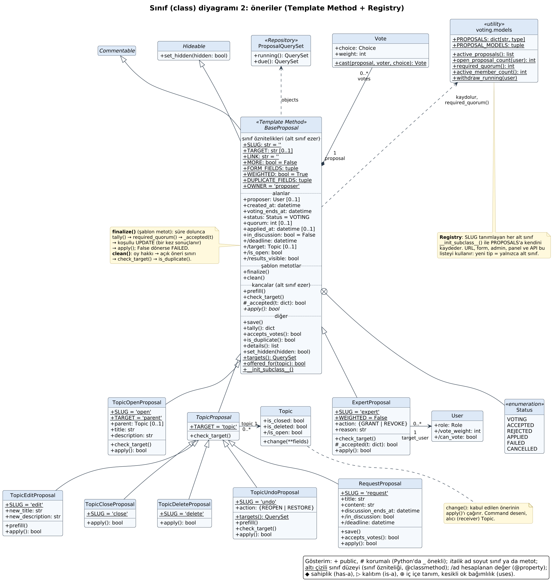
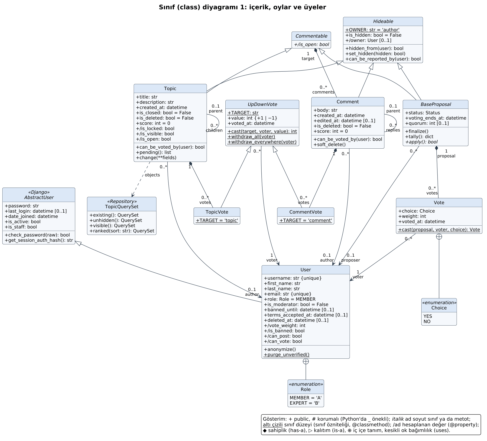
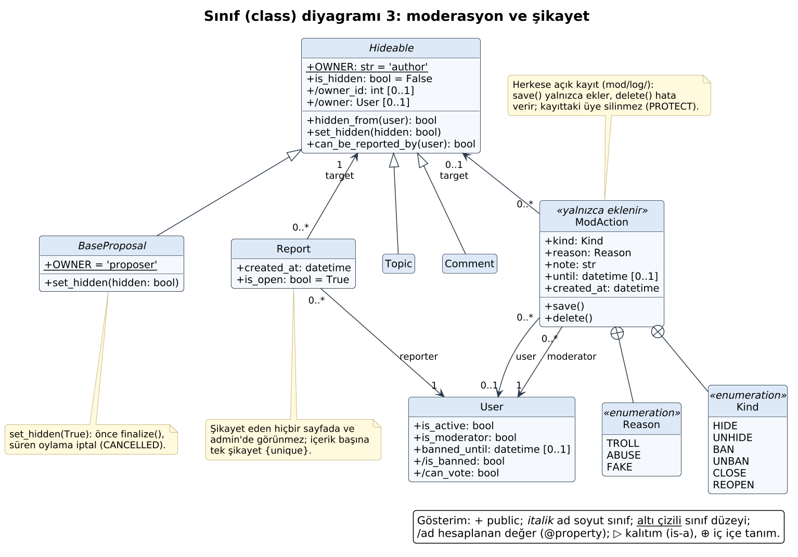
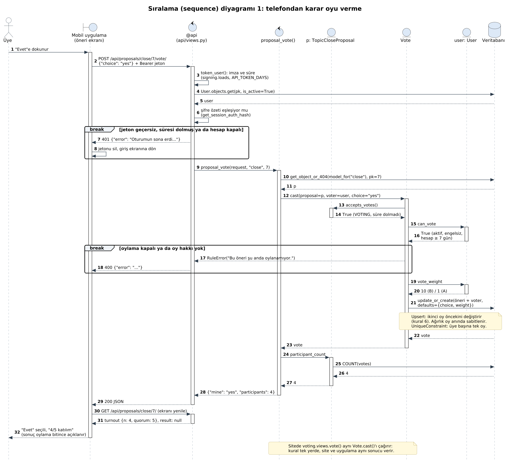
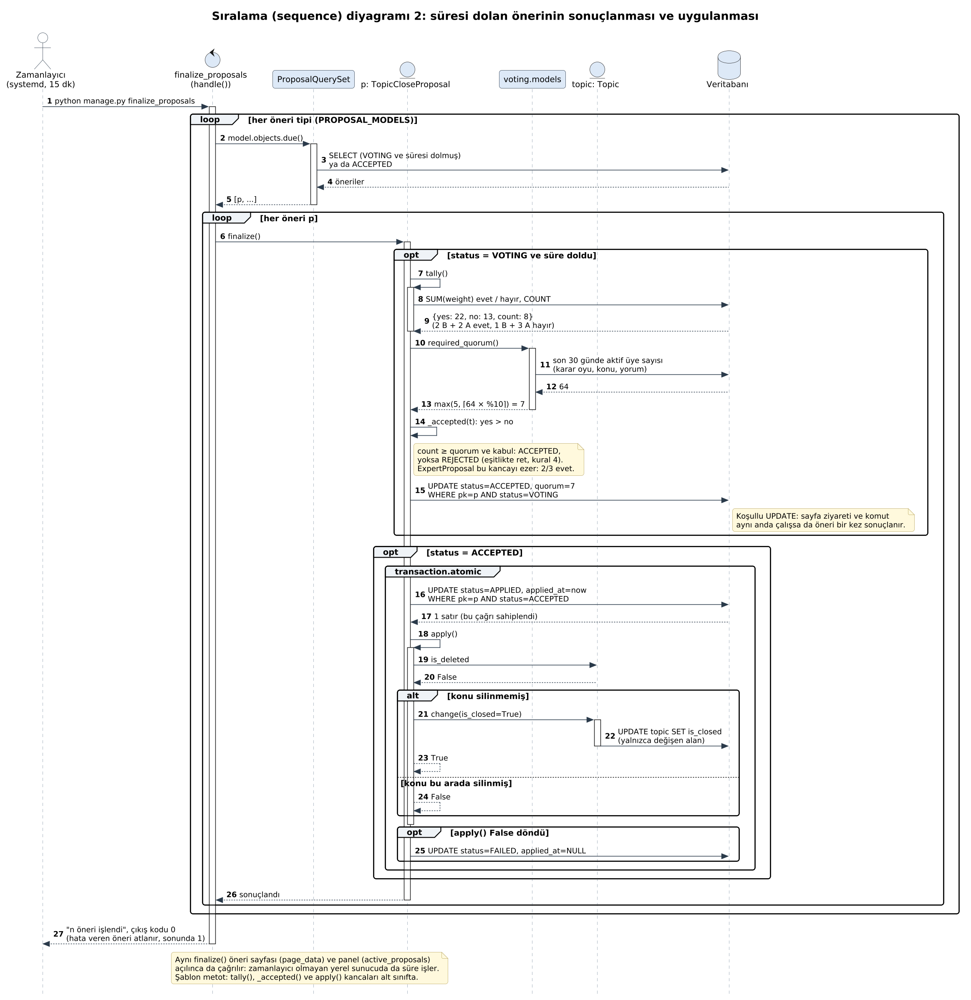
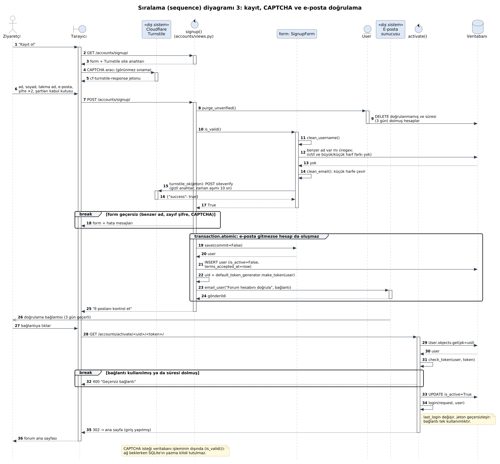
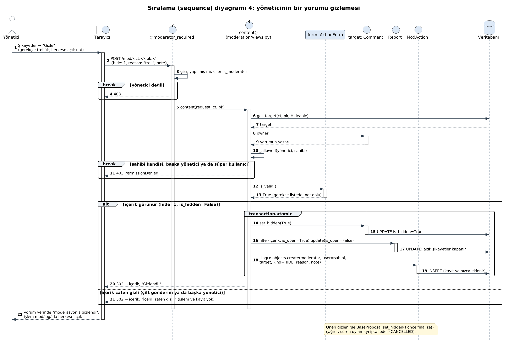

# Tasarım: ilkeler, desenler, inceleme

Bu belge 12. adımın çıktısıdır: SOLID ilkelerinin ve tasarım desenlerinin projedeki yeri, bilerek uygulanmayan
desenler, anti-desen denetimi, testler, inceleme sırasında bulunup düzeltilen hatalar ve UML diyagramları. Problemin çerçevesi,
başarı ölçütleri ve gereksinimler `ANALIZ.md`'de. Dayanak: dersin "Tasarım Desenleri" slaytları (GoF, SOLID,
Registry, Repository, anti-desenler, desen seçim rehberi).

## 1. Yöntem

- **12 ayrı inceleme.** Her ilke ya da konu için ayrı bir alt ajan bütün projeyi (Python, şablonlar, CSS/JS, mobil
  TypeScript) baştan sona okudu: SRP, OCP, LSP, ISP, DIP, DRY, KISS/YAGNI, GoF desenleri, anti-desenler, test
  edilebilirlik, doğruluk (hata avı), güvenlik. Ajanlar depoya yazmadı, iddialarını kopyada yeniden üretti.
- **Doğrulama.** Her bulguyu ayrıca denedim: hata iddiası bir testle yeniden üretildiyse "gerçek hata", üretilemediyse
  ya da bilinçli bir kararsa ayrıldı. Birden çok ajanın bulduğu hata (ör. admin'de üye silme) tek kayıt sayıldı.
- **Sonuç.** 28 gerçek hata düzeltildi (bölüm 7'de 22 satır: aynı kökten olanlar birlikte). Sunucudakilerin hepsi
  için regresyon testi var; mobildekiler tip denetiminden geçti, telefonda deneme kullanıcıda. Yapı iyileştirmeleri
  yalnızca bir hatayı ya da tekrarı ortadan kaldırdığında yapıldı. Kalanlar gerekçesiyle bölüm 4 ve 8'de.
- **Ölçüm.** Testler 133 → 191. Mutasyon testi (kod bilerek bozulur, testler yakalıyor mu?) %55 → %94 (bölüm 6).

## 2. SOLID

| İlke | Projede | Bu adımda |
| --- | --- | --- |
| **S** Tek sorumluluk | Yetenekler ayrı soyut sınıflarda: `Hideable` (moderasyonla gizlenebilir), `Commentable` (yorum alabilir), `UpDownVote` (▲/▼). Kurallar ortak fonksiyonlarda; site görünümü yalnızca HTML'e, API yalnızca JSON'a çevirir. `config/utils.back()` yalnızca güvenli geri dönüş. | Konuyu değiştirmek konunun işi: `Topic.change()` (öneri yalnızca neyin değişeceğini söyler). Yumuşak silme `Comment.soft_delete()`. Kayıt görünümündeki toplu silme `User.purge_unverified()`'a. Panel önbelleğini temizleme işi `accounts` ve `moderation`'a sızmıştı: önbellek kaldırıldı (bölüm 5). |
| **O** Açık/kapalı | Yeni öneri tipi = yeni alt sınıf. | Önceden 7 tip üç yerde elle sayılıyordu (modeller, admin ×2), konu sayfasındaki öneri bağlantıları şablonda, API'de ve uygulamada ayrı ayrı yazılıydı, `new_form` içinde `model is TopicUndoProposal` vardı. Şimdi tipler kendini kaydeder (Registry), hedef kümesi `targets()`, bağlantı `LINK` + `offered_for()`, sayfa/API ayrıntıları `details()` tipte. **Yeni tip için değişen dosya yalnızca `voting/models.py` (+ göç).** ▲/▼ oy türleri de: `UpDownVote.withdraw_everywhere()`. |
| **L** Liskov | `Topic` ve öneriler aynı atalardan (`Commentable`, `Hideable`): yorum bölümü, şikayet ve moderasyon hangisi olduğunu bilmeden çalışır. | Üç ihlal düzeltildi: `RequestProposal.save()` verilen oylama bitişini eziyordu (taban korur); `deadline` tabanda yalnızca istekte olan `discussion_ends_at`'e dayanıyordu (taban `voting_ends_at`, istek ezer); `ExpertProposal._accepted` hiç oy yokken kabul diyordu (taban ret der). |
| **I** Arayüz ayrımı | Öneri formu yalnızca tipin `FORM_FIELDS`'ını gösterir. | `BaseProposal` her tipin bir `topic` alanı olduğunu varsayıyordu; konu açma ve bilirkişilik önerisinin konusu yok. Ara soyut sınıf `TopicProposal`: konu alanı ve kural 7 denetimi yalnızca konuya yönelik 5 tipte. Göç gerekmedi (`makemigrations --check` temiz). |
| **D** Bağımlılığın tersine çevrilmesi | Django'nun arka uçları ayardan: `DATABASES` (SQLite ↔ PostgreSQL), `MAILERS` (konsol ↔ SMTP). Kod ORM'e ve `send_mail`'e bağlı, gerçeklemeye değil. | Görünümler "kural ihlali" soyutlamasına bağlı: `config/errors.RuleError`; artık her `ValueError`'ı kullanıcı mesajı sanmıyorlar. CAPTCHA için ayrı bir arka uç ayarı düşünüldü, yapılmadı (YAGNI: tek gerçekleme); test tarafı `mock.patch` ile sahte `urlopen`. |

Slayttaki gibi Python `Protocol` sınıfları yazmadık: tip denetleyici çalıştırmıyoruz, aynı ayrımı soyut Django modelleri
kuruyor (alan da taşıyabiliyorlar).

## 3. Desen haritası

Öneri sınıfları, UML sınıf diyagramıyla (öteki diyagramlar bölüm 9'da):

| Desen | Tür | Nerede | Roller ve neden |
| --- | --- | --- | --- |
| **Template Method** | Davranışsal | `BaseProposal.finalize()`, `clean()` (`voting/models.py`) | Akış sabit: süre doldu mu → yeter sayı → kabul → uygula. Değişen adımlar kanca: `check_target`, `prefill`, `_accepted`, `accepts_votes`, `apply`. Aynı desen: `UpDownVote.cast` (kanca `can_be_voted_by`), Django'nun `BaseCommand.handle`'ı, şablon kalıtımı (`base.html`'in blokları). |
| **Registry + Factory Method** | Yaratımsal / ek | `PROPOSALS` ve `BaseProposal.__init_subclass__`; `voting.views.model_for()` | Slayttaki `@KAYIT.kaydet("ad")` gibi: `SLUG`'ı olan her tip tanımlanırken kendini kaydeder, aynı ad ikinci kez kaydedilemez. URL'deki tip adından sınıf bulunur. Admin, panel, komut ve form aynı listeyi kullanır. Django'da da: `admin.site.register`, şablon kütüphanesi `register`; uygulamada Expo Router (dosya yolu = ekran). |
| **Strategy** | Davranışsal | `_accepted` (kural 4 ↔ kural 2'nin 2/3'ü), `WEIGHTED`; `SORTS` ve `TABS` sözlükleri (`topics`) | Kabul kuralı tipe göre değişir; sıralama ve süzgeç adresten seçilir. Python'da strateji sınıfı yerine sözlük ve fonksiyon. |
| **Command** | Davranışsal | `apply()` + 7 tip; çağıran `finalize()` ve `finalize_proposals` komutu (sunucuda 15 dk'lık zamanlayıcı); alıcı `Topic.change()`, `User` | Öneri bir isteği nesneye çevirir: saklanır, 2 gün (istekte 3+3) kuyrukta bekler, sonra çalışır; geri alma da bir komut (`TopicUndoProposal`). Slayttaki rehber: "işlemleri saklamak, kuyruğa almak, geri almak". |
| **Repository** | Ek (Fowler) | `TopicQuerySet` (`existing`, `unhidden`, `visible`, `ranked`), `ProposalQuerySet` (`running`, `due`) | Koleksiyon alan diliyle sorgulanır; görünümler "silinmemiş ve üstü gizli olmayan" gibi koşulları bilmez. "Süren öneri" koşulu önceden üç yerde ayrı yazılıydı. |
| **Facade** | Yapısal | Site ve API'nin ortak fonksiyonları: `listing`, `page_data`, `section`, `create`, `new_form`, `file_report`; şablon etiketleri `active_panel`, `comment_section`, `mod_links`; mobilde `api()` | Karmaşık alt sistemi tek çağrıyla sunar; kural değişince tek yer. |
| **Decorator** | Yapısal | `@api(...)` (yöntem, jeton, JSON gövde, hata çevirisi), `moderator_required`, `login_required`, `sensitive_post_parameters` | Görünümün kendisini değiştirmeden davranış ekler. Python'un `@`'i fonksiyonu sarar, GoF'unki nesneyi; amaç aynı. |
| **Adapter** | Yapısal | `turnstile_ok` (Cloudflare yanıtı → `bool`), API'nin model → JSON çevirileri, mobilde `store` (SecureStore ↔ localStorage) | Dış arayüzü uygulamanın beklediğine çevirir. |
| **Composite** | Yapısal | Konu / alt konu (`parent`, `children`), yorum / yanıt | Yaprak ve düğüm aynı işlenir (API ve uygulama yorumu özyineli çizer); derinlik kuralla 2. |
| **Iterator** | Davranışsal | `Paginator.get_page`, mobilde `usePaged` (kaydırdıkça sonraki sayfa) | Büyük listeye sıralı erişim. |
| **Observer** | Davranışsal | `static/js/site.js` (form olayı), `sw.js` (`install`/`activate`/`fetch`), mobilde `onSessionEnd` ve React durumu | Olay olunca ilgililer haberdar olur. Django sinyali bilerek yok (bölüm 4). |
| **Proxy** | Yapısal | Service worker (`templates/pwa/sw.js`), ORM'in tembel yüklemesi | İçerik hash'li statik dosyalar için önbellek vekili; sayfalar hep ağdan. |
| **Chain of Responsibility** | Davranışsal | `MIDDLEWARE`; `clean()`'deki sıralı denetimler | Her halka isteği işler ya da geçirir; `clean()` ilk hatada durur. |
| **Builder** | Yaratımsal | QuerySet zinciri: `visible().filter(...).select_related(...).ranked(sort)` | Sorgu adım adım kurulur, en sonda çalışır. |
| **Singleton** | Yaratımsal | `django.conf.settings`, `FORUM`, `admin.site` | Python modülü zaten tekil. |
| **Bridge** | Yapısal | Django'nun veritabanı ve e-posta arka uçları | Soyutlama (ORM, `send_mail`) ile gerçekleme (SQLite/PostgreSQL, konsol/SMTP) ayrı değişir. |
| **Flyweight** | Yapısal | Mobil `themed()` | Tema başına tek StyleSheet, bütün bileşenler paylaşır. |
| **Null Object** | Ek | `AnonymousUser` | Girişsiz kullanıcı da kullanıcı gibi sorulabilir (`is_authenticated`, `pk`). |
| **State** (dejenere) | Davranışsal | `BaseProposal.Status` + `finalize()`'daki geçişler | Durum sınıfları yok (bölüm 4). |

## 4. Bilerek uygulanmayanlar (YAGNI / KISS)

Slayttaki kural: desen, ihtiyaç ortaya çıktığında uygulanır.

- **State sınıfları:** 6 durum, geçişler iki `if` ve tek SQL `UPDATE ... WHERE status=...` (iki istek aynı anda
  sonuçlandırsa da öneri bir kez uygulanır). Durum nesneleri kodu uzatır, bu yarış güvenliğini bozardı.
- **Django sinyalleri (Observer):** durum geçişleri `QuerySet.update()` ile yapılıyor, sinyal göndermez; tetikleyecek
  bir işlem (ör. bildirim) yok.
- **Servis katmanı (`services.py`):** ortak fonksiyonlar `views.py`'de, tek ek tüketici API. Ayrı katman bugün bir
  hatayı çözmüyor.
- **CAPTCHA arka uç ayarı:** tek gerçekleme; test için `mock.patch` yeterli.
- **Abstract Factory, Prototype, Visitor, Mediator, Memento, Interpreter:** kullanım yeri yok. `details()` Visitor
  yerine Django'nun alan tanımlarını (`_meta`) okur.
- **Mobilde ortak yükleme kancası (`useLoad`) ve moderasyon/şikayet bileşeni:** iki üç ekranda benzer kod var.
  Telefonda denemeden arayüzü yeniden düzenlemedik; açık borç (bölüm 8).

**Slayt 59, tartışma: Python'un dinamik doğası hangi GoF desenlerini gereksiz kılıyor?** Bu projede:

- Strategy → sözlük ve fonksiyon (`SORTS`, `TABS`), ayrı strateji sınıfı yok.
- Singleton → modül (`settings`, `FORUM`).
- Iterator → `for` protokolü ve üreteçler.
- Decorator → `@` sözdizimi.
- Factory/Registry → sınıf zaten çağrılabilir, kayıt için sözlük ve `__init_subclass__` yeter.
- Visitor → çift gönderim gerekmez, yansıma (`getattr`, `_meta`).
- Command → çağrılabilir nesne yeter. Burada saklanması ve oylanması gerektiği için model oldu.

**Kullandığımız kütüphanelerde gördüğümüz desenler:**

- **Django:**
  - Template Method: sınıf tabanlı görünümler, `BaseCommand`.
  - Registry: `admin.site`, `INSTALLED_APPS`.
  - Chain of Responsibility: middleware.
  - Observer: sinyaller.
  - Bridge: veritabanı arka uçları.
  - Proxy ve Builder: tembel, zincirlenen QuerySet.
- **React:**
  - Composite: bileşen ağacı.
  - Observer: durum ve efektler.

## 5. Anti-desen denetimi (slayt 57)

| Anti-desen | Durum |
| --- | --- |
| God Object | `voting/models.py` en büyük dosya (~600 satır: oy, öneri tabanı, 7 tip, yeter sayı). Her şeyi bilen tek sınıf yok; Django'da bir uygulamanın modelleri tek dosyada olağan. İzleniyor. |
| Spagetti kod | Yok: akışlar Template Method ile sabit. |
| Altın çekiç | Her yere desen konmadı (bölüm 4). |
| Singleton bağımlılığı | `settings.FORUM` global ama testlerde `override_settings` ile değişir. Süreçler arası paylaşılan panel önbelleği kaldırıldı. Mobilde jeton modül düzeyinde (tek oturum, bilinçli). |
| Erken soyutlama / optimizasyon | `VOTING_DAYS_SETTING` (hiç ezilmeyen kanca) silindi. Panel önbelleği kaldırıldı: ölçülen kazanç 30 öneride yaklaşık 9 ms, bedeli `createcachetable` adımı ve dört dosyaya yayılan temizleme kodu; adım unutulunca taze kurulumda ana sayfa 500 veriyordu. Panel artık hep güncel (katılım sayısı 1 dk geç gelmiyor). |
| Glue code | Site şablonu, API ve uygulama arasında elle eşlenen üç liste tek kaynağa bağlandı: öneri bağlantıları (`topics.views.proposal_links`), rozetler (`Topic.pending`), öneri ayrıntıları (`BaseProposal.details`). |
| Ölü (deney) kodu | `BaseProposal.Meta.ordering` hiçbir modele geçmiyordu; girilmeyen dallar (`if self.proposer_id`, `if not self.topic_id`, `elif old`) ve kullanılmayan CSS seçicisi silindi. |
| Yapılandırma borcu | Kural sayıları (`FORUM`) açılışta denetleniyor: `voting/checks.py` (Django system check). Yanlış değer artık sayfada 500 değil, `runserver` ve `check --deploy`'da açık bir hata. Ayardan gelen şema değerleri (`max_length`) için `makemigrations --check` testi var. |
| Pipeline jungle, notebook'tan üretime | Yok (veri hattı ve notebook yok). |

## 6. Testler

`python manage.py test`: **191 test** (önce 133), SQLite'ta 20 saniyenin altında. İnceleme sırasında eski takım
PostgreSQL 16'da da geçti.

Slayttaki ödevin 6. maddesi "her bileşen için en az bir birim testi (sahte bileşenle)". Bu projede karşılığı:

| Bileşen | Test | Sahte (fake/mock) |
| --- | --- | --- |
| Kabul kuralı (Strategy), yeter sayı | `voting.tests.RuleTests` | Veritabanısız; sahte oy toplamı sözlüğü, `mock.patch` ile sahte aktif üye sayısı |
| Registry ve tip sözleşmesi | `voting.tests.RegistryTests` | Veritabanısız |
| Konu sayfası bağlantıları (`offered_for`) | `voting.tests.LinkTests` | Kaydedilmemiş konular, `SimpleNamespace` sahte kullanıcı; `SimpleTestCase` sorguyu yasaklar, yani bağlantılar sorgusuz |
| Öneri ayrıntıları | `voting.tests.DetailsTests` | Veritabanısız |
| Ayar denetimi | `voting.tests.SettingsCheckTests` | Bozuk ayar sözlüğü (`override_settings`) |
| CAPTCHA (Adapter) | `accounts.tests.TurnstileTests` | Sahte `urlopen` (ağ yok) |
| Sorgu ↔ nesne ikizleri (Repository) | `topics.tests.TwinTests` | 72 bayrak birleşimi |
| Süre/tarih süzgeçleri, `as_pk` | `config.tests.UtilsTests` | Veritabanısız |
| Renk kontrastı (İOG-4) | `config.tests.DesignTests` | CSS dosyası okunur |
| Öneri yaşam döngüsü, moderasyon, API, hesap | `LifecycleTests`, `IntentTests`, `AdminPrivacyTests`, `api.tests` | Django'nun test veritabanı (her test boş, bellekte) ve bellek içi posta kutusu (`mail.outbox`) |

Django'nun test veritabanı "sahte depo"nun Django karşılığıdır: üretimdeki SQL çalışır ama her test boş ve
bellekte başlar. Gerçek dış servis (Cloudflare, SMTP) hiçbir testte çağrılmaz.

**Mutasyon testi.** Kodda tek satırlık bilinçli hatalar yapılıp (ör. "eşitlikte kabul", "silme uygulanmıyor",
"şikayet edeni göster") takımın bunları yakalayıp yakalamadığına bakıldı:

| | Mutant | Yakalanan | Skor |
| --- | --- | --- | --- |
| Önce (133 test) | 102 | 55 | %55 |
| Sonra (191 test) | 129 | 121 | %94 |

Eski 102 mutanttan 3'ünün kodda karşılığı kalmadı (panel önbelleği kaldırıldı), 99'u yeni koda uyarlandı. Düzeltilen her hata ve her yeni bileşen için bir mutant eklendi (30): hatayı geri getiren değişikliği testler yakalamalı; 30'unun hepsi yakalandı. Yaşayan 8'i: yayın ayarları (CSP, STARTTLS; yalnızca `DEBUG` kapalıyken etkin), tarayıcıda çalışan service worker ve JS (Python testleri görmez), favicon yönlendirmesi ve bir eşdeğer mutant: hesap silmede `logout()` kaldırılsa da oturum düşer, çünkü şifre özeti değişir.

## 7. Bulunan ve düzeltilen hatalar

Sunucudakilerin her biri bir testle yeniden üretildi, düzeltildi ve regresyon testi aldı; mobildekiler (22. satır)
tip denetiminden geçti, telefonda denenecek.

| # | Hata | Düzeltme |
| --- | --- | --- |
| 1 | Admin'de üye silme onay sayfası üyenin oylarını yönüyle ("…: yes") listeliyordu; onaylanırsa oylar silinip bitmiş oylamaların sonucu değişiyordu (kural 6, 4). Şikayet edenin kimliği de bu sayfadan çıkıyordu. | Admin'de üye silme kapalı (hesap silme `anonymize()` ile üyenin kendisinde); `Vote.__str__` oyu yazmıyor. |
| 2 | Admin adres süzgeçleri (`?reporter=`, `?vote=`, `?votes=`) şikayet edeni ve kimin hangi oylamaya katıldığını gösteriyordu. | `PrivateLookups` (bu süzgeçler 400). |
| 3 | Kuruluş bittikten sonra da admin'den hesap açılıp kayıt tarihi geri alınabiliyordu: kural 1'deki hesap yaşı atlanıyordu. | `FOUNDING=False` iken hesap ekleme kapalı, kayıt tarihi salt okunur. |
| 4 | Yönetici kendi (ya da başka yöneticinin) içeriğine gelen şikayetleri kayda düşmeden kapatabiliyordu. | Şikayet kapatma da yetki ister. |
| 5 | Gizleme niyeti içeriğin o anki hâlinden çıkarılıyordu: çift tıklama ya da aynı anda iki yönetici gizlemeyi geri çeviriyordu. | Niyet düğmede (`hide=1/0`); içerik zaten öyleyse işlem ve kayıt yok. |
| 6 | Taze kurulumda `createcachetable` unutulursa ana sayfa 500. | Panel önbelleği kaldırıldı (bölüm 5). |
| 7 | Yerelde (zamanlayıcı yok) süresi dolan öneri sonuçlanmıyor, açık öneri kotasını tutuyor, panelden ve rozetlerden kayboluyordu. | Panel ve açık öneriler vadesi geleni sonuçlandırır; kota yalnızca süren öneriyi sayar (`running()`). |
| 8 | Kayıtta CAPTCHA'nın ağ isteği (≤10 sn) veritabanı işleminin içindeydi: SQLite'ın yazma kilidi tutuluyordu. | İşlem yalnızca hesabı kaydetme ve e-posta. |
| 9 | Moderasyonla kapatılmış, hiç giriş yapmamış bir hesap varken her kayıt denemesi 500 (`ProtectedError`). | Doğrulanmamış hesap temizliği moderasyon kaydındaki hesaba dokunmaz. |
| 10 | Hesap silme: anonimleştirmede yazılan ad pk'den türüyordu; biri o adla önceden kayıt olursa silme 500 (KVKK'daki silme hakkı engellenebilir). | Rastgele ad ve e-posta. |
| 11 | Kayıt ve hesap silmede şifre, 500 hata e-postasında düz metin görünüyordu. | `sensitive_post_parameters`. |
| 12 | `?parent=²` (Unicode rakam): sitede 500, API'de ve yorumda Django'nun iç hata mesajı. | `config/utils.as_pk()` yalnızca ASCII rakam. |
| 13 | API: çok derin iç içe JSON gövde 500 veriyordu; girişte bayat jeton doğru şifreyi bile 401 yapıyordu; `{"value": true}` ▲ sayılıyordu (PostgreSQL'de 500). | `RecursionError` 400; girişte jeton okunmaz; `bool` oy değil. |
| 14 | Programlama hatası olan bir `ValueError` kullanıcıya kural mesajı gibi gösteriliyordu (500 ve hata e-postası yerine). | `RuleError`: görünümler yalnızca onu yakalar. |
| 15 | "En popüler" silinmiş yorumların ▲/▼ oylarını sayıyordu. | Sayımda silinmiş yorum hariç. |
| 16 | "Kapalı" sekmesi adreste verilen "en popüler"i kabul ediyordu (orada yorum ve oy yok). | Sıralama sekmenin seçeneklerinde aranır. |
| 17 | Geri alma önerisi, gizlenmiş ana konunun alt konusuna açılabiliyordu (gizli ana konunun altı donar). | `Topic.objects.unhidden()`, `TopicUndoProposal.targets()`. |
| 18 | Açık öneriler sayfası panelden ve API'den farklı sıralıyordu. | Sıra tek yerde (`active_proposals`, evrenin bitişi). |
| 19 | İstek önerisi verilen oylama bitişini eziyordu; bilirkişi önerisi hiç oy almadan kabul sayılabiliyordu (yeter sayı 0 yapılırsa). | Bölüm 2, Liskov. |
| 20 | Yorum düzenleme bütün satırı yazıyordu: aynı anda gelen ▲/▼ puanı ya da moderasyon gizlemesi eziliyordu. | Yalnızca metin ve düzenlenme zamanı yazılır. |
| 21 | Aynı anda açılan konu ve yorumların sırası belirsizdi: sayfalamada tekrar ya da atlama. | Son sıralama ölçütü `pk`. |
| 22 | Mobil: ağ hatasında oturum düşmüş görünüyordu; hızlı çift dokunuş ▲'yı geri alıyordu; JSON olmayan başarılı yanıt boş nesne sayılıyordu. `/mod/log/?user=%00` PostgreSQL'de 500. | `auth.tsx`, `Vote.tsx`, `api.ts`; NUL temizlenir. |

## 8. Açık noktalar

- Giriş ve şifre sıfırlamada hız sınırı yok; jeton iptali ("bütün cihazlardan çık") yok.
- Gizlenmiş ana konunun alt konusu kendi sayfasında okunabilir (listelerden çıkar, donar): tasarım kararı.
- Yeter sayı, sonuçlanma anındaki aktif üye sayısıyla hesaplanır (sonuçlandırma tembel; sunucuda en geç 15 dk).
- Mobilde tekrar eden yükleme kodu ve otomatik test yok (tip denetimi `tsc --noEmit` var).
- Sürekli entegrasyon (CI) yok: `manage.py test` ve `tsc --noEmit` elle çalıştırılıyor.
- Takma ad taklidinde yalnızca harf büyüklüğü, i/ı/I/İ ve Kiril harfleri engelli; "l" ile "I" gibi benzerlikler değil.

## 9. UML diyagramları

Diyagramlar koddan çıkarıldı: sınıf, alan ve metot adları kodla aynı. Kaynaklar `diyagramlar/*.puml` (PlantUML,
ortak görünüm `stil.iuml`), PNG'ler yanlarında. Gösterim slayttaki gibi: italik ad soyut sınıf, içi boş üçgen
kalıtım, ◆ sahiplik (has-a), kesikli ok bağımlılık (uses). Ayrıca çokluklar (`1`, `0..1`, `0..*`), `+`/`#`
görünürlük (`#`: Python'da `_` önekli), altı çizili sınıf düzeyi üye (sınıf özniteliği, `@classmethod`) ve `/ad`
hesaplanan değer (`@property`). Model ya da akış değişince diyagram da güncellenir; PNG'ler
`java -jar plantuml.jar -tpng diyagramlar/*.puml` ile (Graphviz gerekir) ya da VS Code'un PlantUML eklentisiyle
üretilir.

| Diyagram | Dosya | Ne gösteriyor |
| --- | --- | --- |
| Kullanım durumu | `kullanim-durumu` | 6 aktör ve 2 dış sistem, 26 kullanım durumu; `<<include>>`, `<<extend>>`, aktör ve kullanım durumu genellemesi. Gereksinimlerle eşleşmesi `ANALIZ.md` 11'de. |
| Sınıf 1: içerik, oylar ve üyeler | `sinif-1-icerik` | Alan modeli: iki yetenek tabanı, ▲/▼ ve karar oyu, çokluklar |
| Sınıf 2: öneriler | `sinif-2-oneriler` | Template Method, Registry, Repository, Command (bölüm 3) |
| Sınıf 3: moderasyon | `sinif-3-moderasyon` | Şikayet ve yalnızca eklenen moderasyon kaydı |
| Sıralama 1 | `sira-1-karar-oyu` | Telefondan karar oyu: jeton, `Vote.cast()`, kural 6 |
| Sıralama 2 | `sira-2-sonuclanma` | Zamanlayıcı → `finalize()` → yeter sayı → koşullu UPDATE → `apply()` |
| Sıralama 3 | `sira-3-kayit` | Kayıt, CAPTCHA, tek kullanımlık e-posta bağlantısı |
| Sıralama 4 | `sira-4-gizleme` | Yöneticinin gizlemesi: yetki, işlem, şikayetler, kayıt |

### Sınıf diyagramları

İki soyut "yetenek" sınıfı (Java'daki arayüz gibi, ama alan da taşır) içerik türlerini birleştirir: `Commentable`
yorum alabilen, `Hideable` moderasyonla gizlenebilen her şey. Konu ve öneri ikisinden de türer, yorum yalnızca
gizlenebilir. Yorum bölümü, şikayet ve moderasyon hedefin türünü bilmeden çalışır (Liskov). ▲/▼ oyları
(`UpDownVote`) ile karar oyu (`Vote`) ayrı sınıflar: ağırlık, gizlilik ve aktif üye sayımı farklı.

Moderasyon tarafında `Report` ve `ModAction` hedefe `Hideable` üzerinden bağlanır; yeni bir gizlenebilir içerik
türü kendiliğinden şikayet edilebilir ve kayda düşer.

### Sıralama diyagramları

Dört senaryo sistemin dört önemli yolunu uçtan uca gösterir. Hata yolları `break` (istek orada biter), seçenekler
`alt`, koşullu adımlar `opt`, veritabanı işlemi `transaction.atomic` grubu. Örnekler gerçek adreslerle
(`/api/proposals/close/7/vote/`).

1. **Telefondan karar oyu.** Jeton imzası ve şifre özeti denetlenir, sonra sitedekiyle aynı `Vote.cast()`
   çalışır: kural tek yerde. Oylama sürerken yanıtta yalnızca katılım var (kural 6).

   

2. **Önerinin sonuçlanması.** Şablon metot `finalize()`: `tally()` → `required_quorum()` → `_accepted()` → koşullu
   UPDATE (öneri bir kez sonuçlanır) → `apply()` → `Topic.change()`. Uygulanamazsa "Uygulanamadı".

   

3. **Kayıt ve e-posta doğrulama.** CAPTCHA isteği veritabanı işleminin dışında; hesap ve e-posta tek işlemde
   (e-posta gitmezse hesap da oluşmaz). Doğrulama bağlantısı girişten sonra geçersizleşir.

   

4. **Yöneticinin gizlemesi.** Yetki iki katmanda (`moderator_required`, `_allowed`); gizleme, şikayetlerin
   kapanması ve herkese açık kayıt tek işlemde. Çift gönderim gizlemeyi geri çevirmez.

   
